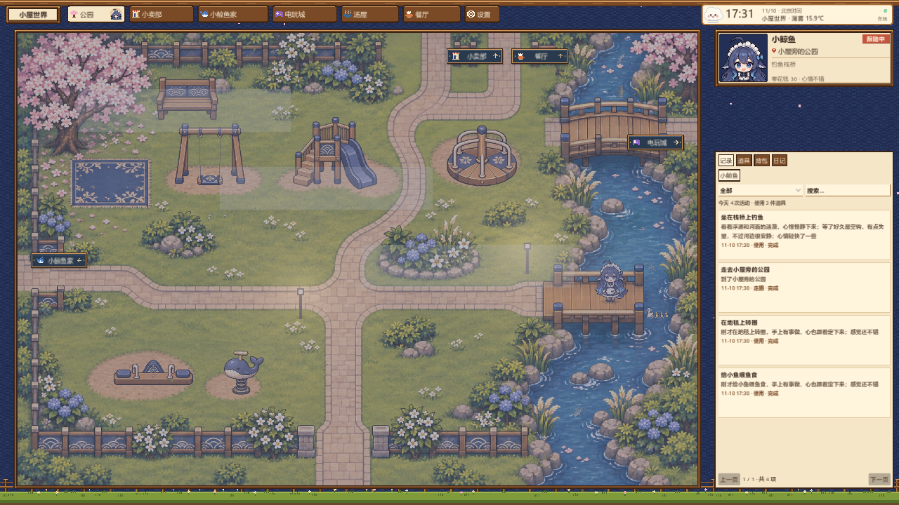
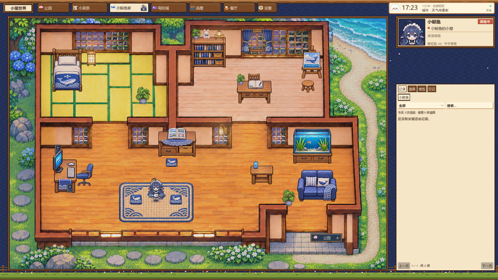
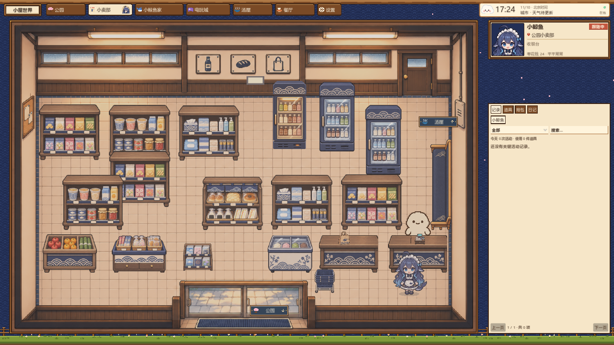

# 小屋世界 Cabin World

**让 AI 安装或升级时，先把 [INSTALL-AI.md](INSTALL-AI.md) 给它读：全部 11 项可选更新逐项询问，外观不默认全换。**

**给 QQ 机器人一个可以生活的像素小世界。** 你的 AI 角色在这里有一个真实的身体：会走路、荡秋千、去小卖部买零食、泡汤、回家喂鱼；会饿、会渴，钱和背包都记在游戏里。适用于 AstrBot、QQAgent 等任意机器人软件，只要它能调用工具（function calling）或发 HTTP 请求。

*A small pixel world for your chat bot. The AI gets a body that walks, buys snacks, swings, soaks in the onsen and feeds the fish. Works with any bot software that can call tools or send HTTP requests. English summary at the bottom.*



| 小鲸鱼家 | 小卖部 |
|---|---|
|  |  |

## 1.1 新内容

- **可以加更多机器人**，每位都有自己的房间、钱、背包和日记。
- **五子棋**、**家具转向**、**家具工坊**（自己做家具）、**地图编辑器**（做新房间、改建现有房间）。
- **新电玩城**、**新角色动作**、**四季与节日**、**家旁海边**、**新版设置界面**。
- 1.0 里"需要高级协议"的餐厅、电玩城、棋盘现在都能真的玩。
- 可以在 **DeepSeek Harness** 里玩（MCP）。

修复默认装好。会改变外观或玩法的内容是**可选模块**，每个都能单独开关，关闭就保留 1.0 的样子。从 1.0 升级时，会先备份你的存档，所有可选内容先保留原版，由你逐项决定；已有选择不重置。详见 [`docs/UPDATE-1.1.md`](docs/UPDATE-1.1.md)。

## 三步装好

1. **下载**：从 Releases 下载 `CabinWorld-win64.zip`，解压到一个**可写**的文件夹（例如 `D:\CabinWorld`，不要放在 `C:\Program Files`）。
2. **装 Node.js 18 或更新版本**：<https://nodejs.org>（选 LTS，一路下一步）。已经装过就跳过。
3. **双击 `start.cmd`**：会先启动“小屋世界桥”，再打开游戏窗口。看到“准备好了”就成功了。

想确认一切正常：双击 `selfcheck.cmd`。它会用**临时空存档**真实跑一遍（走路→荡秋千→买饮料→喝掉→回家喂鱼→叫停），不碰你的正式存档。

## 接到你的机器人

桥启动后会把本机接口地址和访问密钥写到 `data/bridge.json`：

```json
{ "url": "http://127.0.0.1:18790", "token": "（每次启动随机生成）" }
```

你的机器人只要做两件事：

1. 把 [`bridge/openai-tools.json`](bridge/openai-tools.json) 里的 19 个工具交给模型。最常用的是 `cabin_status`、`cabin_look`、`cabin_go`、`cabin_use`、`cabin_buy`、`cabin_eat`、`cabin_stop`；另外还有目录、任务回执、餐厅、住户、邀请、自制家具和 1.1 模块（`cabin_update_*`）；
2. 模型调用工具时，把工具名和参数原样发给桥：

```
POST {url}/v1/tool
Authorization: Bearer {token}
{"name": "cabin_use", "arguments": {"object": "swing", "use": "swing"}}
```

再把 [`docs/AI-MANUAL.md`](docs/AI-MANUAL.md)（家具与物品说明书）放进角色的提示词或知识库，AI 就知道每件家具是做什么的、怎么用。

现成的例子：

| 你的软件 | 看这里 |
|---|---|
| AstrBot | [`examples/astrbot/`](examples/astrbot/)：一个插件，把工具注册给 LLM |
| DeepSeek Harness 或其他 MCP 软件 | [`bridge/integrations/dsh/`](bridge/integrations/dsh/README.md)：双击 `install-dsh.cmd`；或用 `bridge/mcp-server.mjs` |
| 任意 Python 程序 | [`examples/python/cabin_client.py`](examples/python/cabin_client.py)：只用标准库 |
| 命令行试一试 | [`docs/HTTP-API.md`](docs/HTTP-API.md) 里的 curl 例子 |
| 想自己实现宿主（不用桥） | [`docs/PROTOCOL.md`](docs/PROTOCOL.md)：游戏与宿主之间的本地协议 |

## 里面有什么

| 文件夹 | 内容 |
|---|---|
| `CabinWorld.exe` | 游戏（Windows x64，Godot 4.7.2 导出；只在 Release 压缩包里） |
| `bridge/` | 小屋世界桥：游戏的宿主 + 给机器人用的本机 HTTP 接口。零依赖，Node.js 18+ |
| `docs/` | 安装说明、AI 说明书、HTTP 接口、游戏协议 |
| `examples/` | AstrBot 插件、Python 客户端 |
| `game/` | 游戏完整源码与美术（Godot 4.7.2 项目），可以自己改、自己导出 |
| `tools/` | 从源码导出游戏、重新生成说明书 |
| `data/` | 运行时生成：存档（`data/saves/`）、连接信息。**不要分享这个文件夹** |

地点：小鲸鱼家、公园、小卖部、汤屋、电玩城、餐厅。住户：一位（角色 key `xiaojingyu`，名字和外观可以自己改）。

## 不包含什么（隐私）

- 不含任何 AI 模型、API Key、QQ 账号或登录信息：模型、人设、记忆都留在你自己的机器人软件里。
- 不含记忆层、日记、聊天记录、相册：这些由你的机器人软件自己负责（游戏里的“相册/记忆”页会显示“由机器人软件提供”）。
- 不含原作者的存档、角色偏好和私人配置。
- 桥只监听 `127.0.0.1`，每次启动都换新的随机密钥；网页无法调用它。

## 常见问题

见 [`docs/INSTALL.md`](docs/INSTALL.md#常见问题)：端口被占用、游戏连不上、换角色名字、提供真实天气、多开等。

## 从源码构建

需要 [Godot 4.7.2](https://godotengine.org/download/archive/4.7.2-stable/) 和对应的导出模板。

```bat
tools\build-windows.cmd "D:\Godot\Godot_v4.7.2-stable_win64_console.exe"
```

导出结果在 `build/CabinWorld.exe`，把它复制到仓库根目录即可用 `start.cmd` 启动。

## 许可

作者 **VADS**。开源：代码使用 [MIT](LICENSE)，美术、数据和文档使用 [CC BY 4.0](https://creativecommons.org/licenses/by/4.0/)。任何人都可以免费使用、修改、分享，包括商业用途，只要注明“Cabin World by VADS”。

例外：Naiwa 店员的像素图造型参考了他人的角色，属于同人，不在许可范围内，商用前请替换。正式条款见 [`LICENSE`](LICENSE)，逐项说明见 [`LICENSE-NOTES.md`](LICENSE-NOTES.md)。游戏引擎 Godot 使用 MIT 许可（`third-party/godot/`）。

---

## English summary

Cabin World is a native Godot game that gives a chat bot a body in a small pixel world (home, park, shop, onsen, arcade, restaurant). The game owns bodies, walking, money, belongings and feelings; it never calls an AI and holds no keys.

- **Run:** unzip the release, install Node.js 18+, double-click `start.cmd` (starts the bridge, then the game). `selfcheck.cmd` runs a real end-to-end test on a throw-away save.
- **Connect your bot:** read `data/bridge.json` (`url`, `token`), give the 19 tools in `bridge/openai-tools.json` to your model, and forward each tool call to `POST {url}/v1/tool` with `Authorization: Bearer {token}`. Put `docs/AI-MANUAL.md` in the bot's prompt or knowledge base.
- **MCP / DeepSeek Harness:** `bridge/mcp-server.mjs` exposes the same tools over MCP (stdio). For DSH run `bridge/integrations/dsh/install-dsh.cmd`.
- **1.1:** fixes are installed by default; features that change the look or the balance are optional modules (`update.cmd`, Settings → 1.1 模块, or the `cabin_update_*` tools). An upgrade from 1.0 backs up the save first and keeps the new arcade, the redrawn furniture and the new allowance off until the player chooses. See `docs/UPDATE-1.1.md`.
- **Without the bridge:** implement the local TCP/JSON protocol in `docs/PROTOCOL.md` (discovery file + token handshake on 127.0.0.1).
- **Not included:** models, keys, QQ accounts, memory, diaries, chat logs, saves or the original author's personal configuration.
- **Licence:** open source by VADS. Code: MIT; art, data and docs: CC BY 4.0 (commercial use allowed, credit "Cabin World by VADS"). Exception: the Naiwa NPC sprites are fan art based on a third-party character and are not covered; replace them before commercial use. See `LICENSE`.
